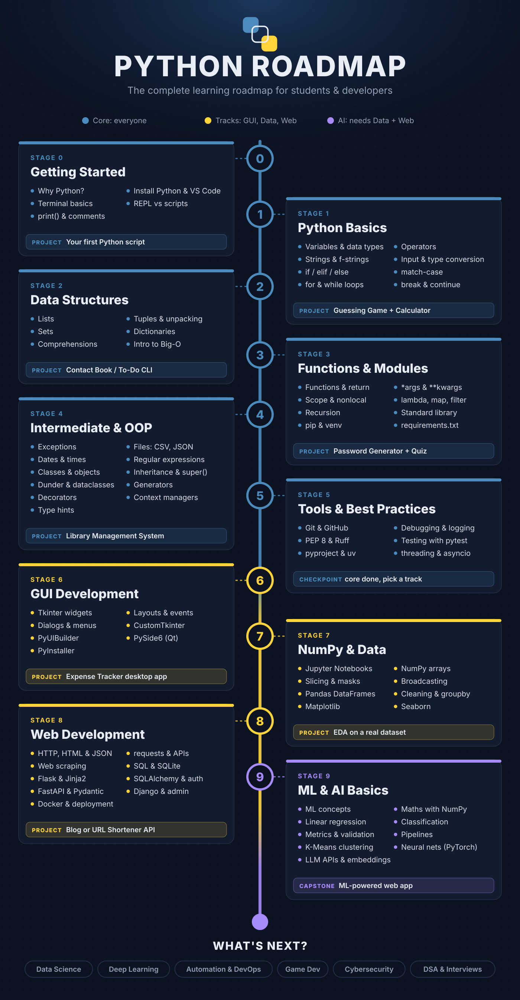
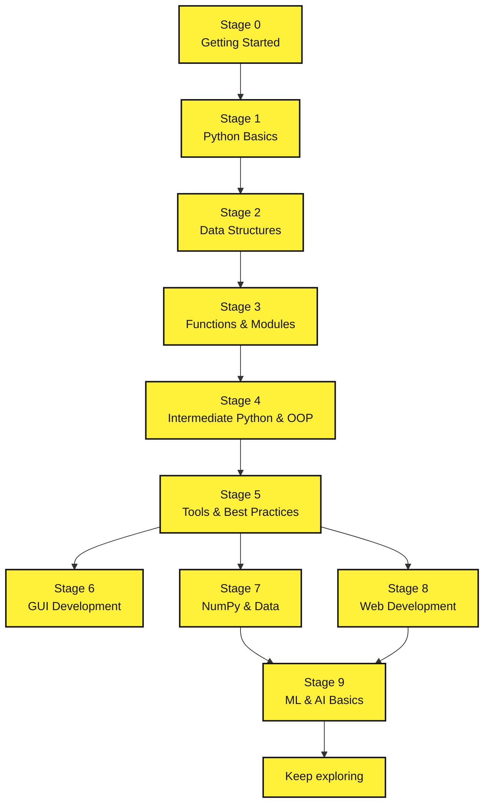

# Python Developer Roadmap

A step-by-step path for students and developers: from your first `print()` to GUIs, NumPy, web development, and the basics of machine learning and AI. Ten stages, with a project at the end of most of them.



---

## How to use this roadmap

1. **Go in order.** Each stage builds on the one before it. Stages 0–5 are the core every Python developer needs; Stages 6–9 are specialisation tracks.
2. **Watch, code, practise.** Every topic has a video, a lesson README, runnable code, and exercises at three levels (Level 1: recall, Level 2: apply, Level 3: challenge).
3. **Build the stage project before moving on.** If you can build it without looking at the solution, you're ready for the next stage.
4. **Tick the boxes.** Fork this repo and check off topics as you finish them (`- [x]`).

| Pace | Lessons / week | Total time |
|---|---|---|
| Relaxed | 3 | ~6 months |
| Steady | 5 | ~4 months |
| Intensive | 10 | ~8 weeks |

> **Prerequisites:** None. A computer (Windows, macOS, or Linux) and curiosity.

---

## The roadmap at a glance



Stages 0–5 are the core. Stages 6–8 are tracks you can take in any order. Stage 9 needs Stage 7, and Stage 8 for the capstone.

---

## Stage 0 — Getting Started
*Goal: set up your machine and run your first program.*

- [ ] Why Python? What you can build, and how this series works
- [ ] Installing Python, VS Code & extensions, and terminal basics
- [ ] Your first program: the REPL vs. scripts, `print()`, comments

---

## Stage 1 — Python Basics
*Goal: write small programs that take input, make decisions, and repeat work.*

- [ ] Variables & data types: `int`, `float`, `str`, `bool`, `None`
- [ ] Operators: arithmetic (`/`, `//`, `%`, `**`), comparison, logical
- [ ] Strings in depth: indexing, slicing, methods, f-strings
- [ ] User input & type conversion (`input()`, `int()`, `float()`)
- [ ] Conditionals: `if` / `elif` / `else` and `match`-`case`
- [ ] Loops: `for`, `while`, `range()`, `break`, `continue`
- [ ] **Project:** Number Guessing Game + CLI Calculator

---

## Stage 2 — Data Structures
*Goal: store and organise data the Pythonic way.*

- [ ] Lists: creating, indexing, slicing, methods
- [ ] Tuples & unpacking
- [ ] Sets & set operations
- [ ] Dictionaries: keys, values, nesting, iteration
- [ ] Comprehensions: list, dict, and set
- [ ] Choosing the right structure + a gentle intro to Big-O
- [ ] **Project:** Contact Book / To-Do List CLI

---

## Stage 3 — Functions & Modules
*Goal: write reusable code and use other people's code.*

- [ ] Functions: `def`, parameters, `return`, returning multiple values
- [ ] Default, keyword, `*args` & `**kwargs` arguments
- [ ] Scope: local, global, `nonlocal`
- [ ] Higher-order functions: `lambda`, `map`, `filter`, `sorted(key=...)`
- [ ] Recursion
- [ ] Modules & the standard library (`math`, `random`, `os`, `datetime`)
- [ ] `pip`, virtual environments (`venv`), and `requirements.txt`
- [ ] **Project:** Password Generator + Quiz App

---

## Stage 4 — Intermediate Python & OOP
*Goal: write robust, well-structured programs.*

- [ ] Errors & exceptions: `try` / `except` / `else` / `finally`, `raise`, custom exceptions
- [ ] File handling: text, CSV, JSON, and `pathlib`
- [ ] Working with dates & times
- [ ] Regular expressions
- [ ] OOP 1: classes, objects, `__init__`, methods
- [ ] OOP 2: inheritance, `super()`, encapsulation, polymorphism
- [ ] OOP 3: dunder methods, `@property`, `dataclasses`
- [ ] Iterators & generators (`yield`)
- [ ] Decorators & context managers (`with`)
- [ ] Type hints & why they help
- [ ] **Project:** Library Management System (OOP + JSON storage)

---

## Stage 5 — Tools & Best Practices
*Goal: work like a professional Python developer.*

- [ ] Git & GitHub for Python developers
- [ ] Debugging: the VS Code debugger, `pdb`, and `logging`
- [ ] Clean code: PEP 8, formatting & linting with Ruff
- [ ] Testing with `pytest`
- [ ] Project structure & packaging (`pyproject.toml`, `uv`)
- [ ] Concurrency intro: `threading`, `multiprocessing`, `asyncio`

> **Checkpoint:** You now know core Python. Pick any track below — or do them all in order.

---

## Stage 6 — GUI Development
*Goal: build desktop apps that people can click on.*

- [ ] GUI concepts & Tkinter basics: windows and widgets
- [ ] Layouts (`pack`, `grid`, `place`) and event handling
- [ ] Forms, dialogs, menus & modern styling (`ttk`, CustomTkinter)
- [ ] Drag-and-drop GUI design with [PyUIBuilder](https://pyuibuilder.com): build a layout visually, export Tkinter/CustomTkinter code, then wire up the logic
- [ ] Intro to PySide6 (Qt): signals & slots
- [ ] Shipping your app as an executable with PyInstaller
- [ ] **Project:** Expense Tracker desktop app (Tkinter + SQLite)

---

## Stage 7 — NumPy & Data
*Goal: work with numbers and real datasets fast.*

- [ ] Jupyter Notebooks & setting up a data environment
- [ ] NumPy arrays: creation, `dtype`, `shape`, reshaping
- [ ] Indexing, slicing & boolean masks
- [ ] Vectorisation, broadcasting, math & statistics
- [ ] Pandas: `Series` & `DataFrame`, reading CSV/Excel
- [ ] Data cleaning, filtering & `groupby`
- [ ] Visualisation with Matplotlib & Seaborn
- [ ] **Project:** Exploratory Data Analysis on a real dataset

---

## Stage 8 — Web Development
*Goal: build and deploy web apps and APIs.*

- [ ] How the web works: HTTP, HTML/CSS basics, JSON
- [ ] Consuming APIs with `requests`
- [ ] Web scraping with BeautifulSoup (and doing it responsibly)
- [ ] SQL fundamentals with SQLite
- [ ] Flask 1: routes, templates (Jinja2), static files
- [ ] Flask 2: forms, databases (SQLAlchemy), authentication
- [ ] FastAPI: REST APIs, Pydantic models, automatic docs
- [ ] Django intro: projects, apps, models, the admin panel
- [ ] Deployment: environment variables, Docker basics, cloud hosting
- [ ] **Project:** Full-stack Blog (Flask) or URL Shortener API (FastAPI)

---

## Stage 9 — Machine Learning & AI Basics
*Goal: understand how ML works and build your first AI-powered app.*
*Needs: Stage 7 (and Stage 8 for the capstone).*

- [ ] What are AI & ML? Types of learning and the ML workflow
- [ ] The maths you actually need (vectors, matrices, statistics) with NumPy
- [ ] scikit-learn & your first model: linear regression
- [ ] Classification: logistic regression, decision trees, KNN
- [ ] Evaluating models: train/test split, metrics, overfitting, cross-validation
- [ ] Feature engineering & scikit-learn pipelines
- [ ] Unsupervised learning: K-Means clustering
- [ ] Neural networks intro with PyTorch
- [ ] Using LLM APIs: prompting, embeddings, building a simple AI assistant
- [ ] **Capstone:** ML-powered web app (trained model + FastAPI/Streamlit, deployed)

---

## What's next?

You've finished the series. Here's where Python can take you next:

| Path | Explore |
|---|---|
| Data Science | Advanced Pandas, statistics, Polars, Kaggle competitions |
| Deep Learning & AI | PyTorch in depth, computer vision, NLP, RAG & AI agents |
| Automation & DevOps | Scripting, `glob`/`shutil`, CI/CD, Infrastructure as Code |
| Game Development | Pygame, Arcade |
| Cybersecurity | Networking with `socket`, Scapy, security tooling |
| DSA & Interviews | Linked lists, trees, hash maps, sorting & searching, LeetCode |
| Open Source | Contribute to Python projects on GitHub |

---

## Repository structure

Each lesson has its own folder, so learners can find the code for any video in seconds.

```
python-developer-roadmap/
├── README.md                     ← this roadmap
├── assets/                       ← roadmap images, thumbnails
├── 00-getting-started/
│   ├── 01-why-python/
│   │   ├── README.md             ← lesson notes + YouTube link
│   │   ├── code/                 ← code shown in the video
│   │   ├── exercises.md          ← levels 1, 2, 3
│   │   └── solutions/
│   ├── 02-setup/
│   └── 03-first-program/
├── 01-python-basics/
│   ├── 04-variables-data-types/
│   ├── ...
│   └── 10-project-guessing-game/
├── 02-data-structures/
├── 03-functions-modules/
├── 04-intermediate-oop/
├── 05-tools-best-practices/
├── 06-gui/
├── 07-numpy-data/
├── 08-web-development/
├── 09-ml-ai/
└── data/                         ← shared datasets used in lessons
```

### Lesson template (GitHub + YouTube)

Use the same layout for every lesson so the series feels consistent:

| Part | In the video | In the repo |
|---|---|---|
| 1. Hook | 30 s: what you'll build or learn | Title + one-line goal |
| 2. Concept | Explain with diagrams | `README.md` notes |
| 3. Live code | Type it from scratch | `code/` |
| 4. Common mistakes | Show real errors and fix them | "Gotchas" section |
| 5. Practice | Set the exercises | `exercises.md` |
| 6. Recap & next | 30 s summary + what's next | Links to prev / next |

**Naming convention:**
- YouTube title: `Python Tutorial #07: User Input & Type Conversion`
- Repo folder: `01-python-basics/07-user-input-type-conversion/`

---

## References & inspiration

- [30 Days of Python](https://github.com/Asabeneh/30-Days-Of-Python) by Asabeneh Yetayeh
- [Python Developer Roadmap](https://roadmap.sh/python) by roadmap.sh
- [Official Python Tutorial](https://docs.python.org/3/tutorial/)

